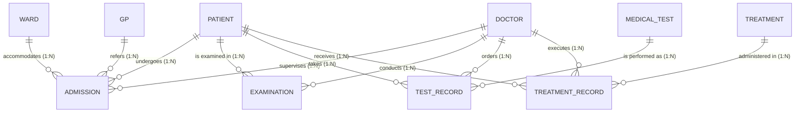

# ACADEMIC PROJECT REPORT
## EXPERIMENT 11: GENERAL HOSPITAL MANAGEMENT SYSTEM
### Course: Database Management Systems (DBMS) Laboratory

---

## 1. COVER PAGE

```
================================================================================
                    DEPARTMENT OF COMPUTER SCIENCE & ENGINEERING
                         [COLLEGE / UNIVERSITY NAME]
                             [CITY, STATE - PIN]
================================================================================

                               LABORATORY REPORT
                                      ON
                    GENERAL HOSPITAL MANAGEMENT SYSTEM (GHMS)
                       (EXPERIMENT NO. 11 - DBMS LAB)

================================================================================

SUBMITTED BY (GROUP MEMBERS):
--------------------------------------------------------------------------------
Name                       Roll Number       Register Number     Signature
--------------------------------------------------------------------------------
[Student Name 1]           [Roll No. 1]      [Reg. No. 1]        ______________
[Student Name 2]           [Roll No. 2]      [Reg. No. 2]        ______________
[Student Name 3]           [Roll No. 3]      [Reg. No. 3]        ______________
[Student Name 4]           [Roll No. 4]      [Reg. No. 4]        ______________

COURSE CODE / TITLE:       CS3491 / DATABASE MANAGEMENT SYSTEMS LABORATORY
SEMESTER / BRANCH:         IV SEMESTER / COMPUTER SCIENCE AND ENGINEERING
ACADEMIC YEAR:             2025 - 2026

UNDER THE ESTEEMED GUIDANCE OF:
[Faculty Advisor / Professor Name], [Designation]
Department of Computer Science & Engineering
[College Name]
================================================================================
```

---

## 2. PROBLEM STATEMENT

Modern general hospitals operate multiple specialized inpatient wards (Maternity, Pediatric, Oncology, Cardiology, Orthopedic, and General Medicine) providing healthcare services to hundreds of patients daily. 

In traditional paper-based or unintegrated environments:
- Inpatient admissions, ward allocations, and bed capacities suffer from duplicate reservations and lack real-time visibility.
- Medical referrals from external General Practitioners (GPs) are recorded informally, preventing verification of primary care referral trails.
- Patients are admitted under designated lead consultants, but during their hospital stay they are evaluated and examined by multiple other doctors (duty medical officers, residents, and consulting sub-specialists).
- Diagnostic investigations (medical tests such as ECGs, CT scans, blood panels) and medical treatments (chemotherapy cycles, surgical fixations, transfusions) are ordered and recorded across separate registers, resulting in billing errors, clinical communication gaps, and data loss.

Therefore, an efficient, fully normalized relational database system using **Oracle SQL** is required to maintain accurate records of patients, wards, doctors, general practitioners, inpatient admissions, clinical examinations, diagnostic tests, test outcomes, and treatments.

---

## 3. OBJECTIVES OF THE PROJECT

1. **Entity-Relationship Modeling:** Design an ER diagram capturing the hospital's clinical and administrative entities, relationships, and cardinalities.
2. **Relational Normalization:** Systematically decompose the unnormalized hospital records into **First Normal Form (1NF)**, **Second Normal Form (2NF)**, and **Third Normal Form (3NF)** to eliminate redundancy and update anomalies.
3. **Oracle Relational Implementation:** Implement the database using Oracle SQL DDL statements, establishing primary keys, foreign keys, unique keys, and domain check constraints.
4. **Data Population & Integrity Verification:** Populate the database with realistic sample records (15 patients, 6 wards, 10 doctors, 5 GPs, 20 admissions, 20 examinations, 10 medical tests, 25 test records, 10 treatments, and 20 treatment records).
5. **Relational Query Operations:** Write and execute standard SQL queries covering basic projection, filtering (`WHERE`, `LIKE`, date functions), multi-table joins (`INNER JOIN`, `LEFT JOIN`), aggregate functions (`COUNT`, `SUM`, `AVG`, `GROUP BY`, `HAVING`), and advanced subqueries (`EXISTS`, `NOT EXISTS`, inline max subqueries).
6. **Constraint & Failure Testing:** Verify that integrity constraints prevent invalid data entry such as duplicate IDs, orphan foreign keys, negative costs, or discharge dates prior to admission dates.

---

## 4. ANALYSIS OF DATA REQUIREMENTS

| Data Category | Information Required | Purpose / Justification | Functional Dependencies |
| :--- | :--- | :--- | :--- |
| **Patient Demographics** | ID, Name, DOB, Gender, Phone, Address, Blood Group | Uniquely identifies patients; required for emergency contact, age calculation, and blood transfusion matching. | `Patient_ID -> Patient_Name, DOB, Gender, Phone, Address, Blood_Group` |
| **Ward Administration** | ID, Name, Type, Location, Capacity | Tracks physical bed inventory and ensures admissions do not exceed ward capacities. | `Ward_ID -> Ward_Name, Ward_Type, Location, Capacity` |
| **Doctor Information** | ID, Name, Specialization, Phone, Email | Stores credentialed physicians and their specialty areas for consultation and clinical procedures. | `Doctor_ID -> Doctor_Name, Specialization, Phone, Email` |
| **GP Referrals** | ID, Name, Clinic Name, Phone | Identifies community clinics referring patients for specialized tertiary hospital care. | `GP_ID -> GP_Name, Clinic_Name, Phone` |
| **Inpatient Admissions** | ID, Patient, Ward, GP, Consultant, Dates, Reason | Manages patient stays, bed allocation, discharge tracking, and consultant billing. | `Admission_ID -> Patient_ID, Ward_ID, GP_ID, Consultant_ID, Admission_Date, Discharge_Date, Reason` |
| **Clinical Examinations**| ID, Patient, Doctor, Date, Findings, Remarks | Provides a dated audit trail of doctor checkups, vital assessments, and progress notes. | `Examination_ID -> Patient_ID, Doctor_ID, Examination_Date, Findings, Remarks` |
| **Medical Test Catalog** | ID, Name, Cost, Description | Maintains standard lab procedure definitions and tariffs. | `Test_ID -> Test_Name, Test_Cost, Description` |
| **Diagnostic Records** | ID, Patient, Test, Doctor, Date, Result, Status | Records individual diagnostic tests ordered for patients with clinical findings and status. | `Test_Record_ID -> Patient_ID, Test_ID, Doctor_ID, Test_Date, Test_Result, Status` |
| **Treatment Catalog** | ID, Name, Cost, Description | Catalogs therapeutic procedures, surgeries, and interventions. | `Treatment_ID -> Treatment_Name, Cost, Description` |
| **Treatment Records** | ID, Patient, Treatment, Doctor, Date, Remarks | Tracks therapeutic interventions administered to patients. | `Treatment_Record_ID -> Patient_ID, Treatment_ID, Doctor_ID, Treatment_Date, Remarks` |

---

## 5. IDENTIFICATION OF ENTITIES AND ATTRIBUTES

1. **PATIENT**: `Patient_ID` (PK), `Patient_Name`, `Date_of_Birth`, `Gender`, `Phone` (UK), `Address`, `Blood_Group`
2. **WARD**: `Ward_ID` (PK), `Ward_Name` (UK), `Ward_Type`, `Location`, `Capacity`
3. **DOCTOR**: `Doctor_ID` (PK), `Doctor_Name`, `Specialization`, `Phone` (UK), `Email` (UK)
4. **GP**: `GP_ID` (PK), `GP_Name`, `Clinic_Name`, `Phone` (UK)
5. **ADMISSION**: `Admission_ID` (PK), `Patient_ID` (FK), `Ward_ID` (FK), `GP_ID` (FK), `Consultant_ID` (FK), `Admission_Date`, `Discharge_Date`, `Admission_Reason`
6. **EXAMINATION**: `Examination_ID` (PK), `Patient_ID` (FK), `Doctor_ID` (FK), `Examination_Date`, `Findings`, `Remarks`
7. **MEDICAL_TEST**: `Test_ID` (PK), `Test_Name` (UK), `Test_Cost`, `Description`
8. **TEST_RECORD**: `Test_Record_ID` (PK), `Patient_ID` (FK), `Test_ID` (FK), `Doctor_ID` (FK), `Test_Date`, `Test_Result`, `Status`
9. **TREATMENT**: `Treatment_ID` (PK), `Treatment_Name` (UK), `Cost`, `Description`
10. **TREATMENT_RECORD**: `Treatment_Record_ID` (PK), `Patient_ID` (FK), `Treatment_ID` (FK), `Doctor_ID` (FK), `Treatment_Date`, `Remarks`

---

## 6. E-R DIAGRAM (MERMAID SPECIFICATION)



---

## 7. RELATIONSHIPS AND CARDINALITIES

- **Ward to Admission (1:N):** One ward accommodates multiple patient admissions. Each admission is allocated to exactly one ward.
- **Patient to Admission (1:N):** One patient can be admitted multiple times over time. Each admission belongs to one patient.
- **GP to Admission (1:N):** One GP clinic refers multiple patients. Each admission records the primary referral GP.
- **Doctor to Admission (1:N):** One doctor supervises multiple admissions as lead consultant.
- **Doctor to Examination (1:N) & Patient to Examination (1:N):** A doctor conducts multiple examinations; a patient undergoes multiple examinations.
- **Patient to Medical Test (M:N via TEST_RECORD):** A patient undergoes many tests; a test is administered to many patients. Resolved by junction entity `TEST_RECORD`.
- **Patient to Treatment (M:N via TREATMENT_RECORD):** A patient receives many treatments; a treatment is given to many patients. Resolved by junction entity `TREATMENT_RECORD`.

---

## 8. NORMALIZATION STEP BY STEP

### A. Unnormalized Form (UNF / 0NF)
Consider a paper hospital register row storing patient, ward, referral, doctor, test, and treatment data in a single unnormalized sheet:

| Hospital_Record (UNF) | Sample Data |
| :--- | :--- |
| Patient_ID | 101 |
| Patient_Name | Rahul Sharma |
| DOB | 1982-05-14 |
| Gender | Male |
| Phone | 9876543210 |
| Address | 12 MG Road, Bangalore |
| Blood_Group | O+ |
| Admission_Dates | 2023-09-01, 2023-10-12 |
| Ward_Details | {Cardiology, B-2, 18}, {Cardiology, B-2, 18} |
| GP_Details | {Dr. Alok Nath, CarePlus}, {Dr. Alok Nath, CarePlus} |
| Tests_Taken | {ECG, 600, Normal sinus}, {Echo, 2500, EF 45%}, {CT Angio, 5500, Patent DES} |
| Treatments_Given | {PCI Stenting, 120000, 2023-09-04}, {Cardioversion, 30000, 2023-10-14} |

**Problems in 0NF:**
1. Multi-valued fields (repeating groups of tests, admissions, and treatments).
2. Impossible to query atomic values with standard relational operators.
3. Huge data redundancy and risk of data loss.

---

### B. First Normal Form (1NF)
**Rule:** A table is in 1NF if all attributes contain atomic (indivisible) values and there are no repeating groups.

**Decomposition to 1NF:**
Flatten the repeating groups by replicating composite candidate keys:
- `PATIENT_1NF(Patient_ID, Patient_Name, Date_of_Birth, Gender, Phone, Address, Blood_Group)`
- `ADMISSION_1NF(Admission_ID, Patient_ID, Ward_Name, Ward_Location, Ward_Capacity, GP_Name, GP_Clinic, Consultant_Name, Admission_Date, Discharge_Date, Reason)`
- `TEST_1NF(Patient_ID, Test_Name, Doctor_Name, Test_Date, Test_Cost, Test_Result)`
- `TREATMENT_1NF(Patient_ID, Treatment_Name, Doctor_Name, Treatment_Date, Treatment_Cost, Remarks)`

**Problems Remaining in 1NF:**
In `TEST_1NF`, the key is `(Patient_ID, Test_Name, Test_Date)`. `Test_Cost` depends only on `Test_Name`, not on `Patient_ID`. This is a **Partial Functional Dependency**, violating 2NF.

---

### C. Second Normal Form (2NF)
**Rule:** A relation is in 2NF if it is in 1NF and no non-prime attribute is partially dependent on any candidate key (full functional dependency).

**Decomposition to 2NF:**
Identify and separate partial functional dependencies into independent master entities:
- `PATIENT(Patient_ID, Patient_Name, Date_of_Birth, Gender, Phone, Address, Blood_Group)` [PK: Patient_ID]
- `MEDICAL_TEST(Test_ID, Test_Name, Test_Cost, Description)` [PK: Test_ID, FD: Test_ID -> Test_Name, Test_Cost]
- `TREATMENT(Treatment_ID, Treatment_Name, Cost, Description)` [PK: Treatment_ID, FD: Treatment_ID -> Treatment_Name, Cost]
- `TEST_RECORD(Test_Record_ID, Patient_ID, Test_ID, Doctor_ID, Test_Date, Test_Result, Status)`
- `TREATMENT_RECORD(Treatment_Record_ID, Patient_ID, Treatment_ID, Doctor_ID, Treatment_Date, Remarks)`

**Problems Remaining in 2NF:**
In `ADMISSION_2NF(Admission_ID, Patient_ID, Ward_ID, Ward_Name, Ward_Location, Ward_Capacity, GP_ID, GP_Name, GP_Clinic, Consultant_ID, Admission_Date, Discharge_Date)`:
`Admission_ID -> Ward_ID` and `Ward_ID -> Ward_Name, Ward_Location, Ward_Capacity`.
`Ward_Location` and `Ward_Capacity` are **transitively dependent** on `Admission_ID` through `Ward_ID`. This violates 3NF.

---

### D. Third Normal Form (3NF)
**Rule:** A relation is in 3NF if it is in 2NF and no non-prime attribute is transitively dependent on the primary key ($X \to Y$ and $Y \to Z$).

**Decomposition to 3NF:**
Extract transitive dependencies into independent master tables:
1. Extract Ward details: `WARD(Ward_ID, Ward_Name, Ward_Type, Location, Capacity)`
2. Extract GP details: `GP(GP_ID, GP_Name, Clinic_Name, Phone)`
3. Extract Doctor details: `DOCTOR(Doctor_ID, Doctor_Name, Specialization, Phone, Email)`
4. Refine `ADMISSION`: `ADMISSION(Admission_ID, Patient_ID, Ward_ID, GP_ID, Consultant_ID, Admission_Date, Discharge_Date, Admission_Reason)`

**Final 3NF Relations:**
All 10 relations (`PATIENT`, `WARD`, `DOCTOR`, `GP`, `ADMISSION`, `EXAMINATION`, `MEDICAL_TEST`, `TEST_RECORD`, `TREATMENT`, `TREATMENT_RECORD`) are now in **Third Normal Form (3NF)**.

---

## 9. LOGICAL DATABASE DESIGN / RELATIONAL SCHEMA

1. `PATIENT(Patient_ID PK, Patient_Name, Date_of_Birth, Gender, Phone UK, Address, Blood_Group)`
2. `WARD(Ward_ID PK, Ward_Name UK, Ward_Type, Location, Capacity)`
3. `DOCTOR(Doctor_ID PK, Doctor_Name, Specialization, Phone UK, Email UK)`
4. `GP(GP_ID PK, GP_Name, Clinic_Name, Phone UK)`
5. `ADMISSION(Admission_ID PK, Patient_ID FK, Ward_ID FK, GP_ID FK, Consultant_ID FK, Admission_Date, Discharge_Date, Admission_Reason)`
6. `EXAMINATION(Examination_ID PK, Patient_ID FK, Doctor_ID FK, Examination_Date, Findings, Remarks)`
7. `MEDICAL_TEST(Test_ID PK, Test_Name UK, Test_Cost, Description)`
8. `TEST_RECORD(Test_Record_ID PK, Patient_ID FK, Test_ID FK, Doctor_ID FK, Test_Date, Test_Result, Status)`
9. `TREATMENT(Treatment_ID PK, Treatment_Name UK, Cost, Description)`
10. `TREATMENT_RECORD(Treatment_Record_ID PK, Patient_ID FK, Treatment_ID FK, Doctor_ID FK, Treatment_Date, Remarks)`

---

## 10. SQL TABLE CREATION COMMANDS

*(Refer to `database/01_create_tables.sql` for the full executable script.)*

```sql
CREATE TABLE PATIENT (
    Patient_ID      NUMBER(6)       CONSTRAINT PK_PATIENT PRIMARY KEY,
    Patient_Name    VARCHAR2(50)    CONSTRAINT NN_PATIENT_NAME NOT NULL,
    Date_of_Birth   DATE            CONSTRAINT NN_PATIENT_DOB NOT NULL,
    Gender          VARCHAR2(10)    CONSTRAINT NN_PATIENT_GENDER NOT NULL,
    Phone           VARCHAR2(15)    CONSTRAINT NN_PATIENT_PHONE NOT NULL,
    Address         VARCHAR2(150)   CONSTRAINT NN_PATIENT_ADDR NOT NULL,
    Blood_Group     VARCHAR2(5)     CONSTRAINT NN_PATIENT_BG NOT NULL,
    CONSTRAINT CHK_PATIENT_GENDER CHECK (Gender IN ('Male', 'Female', 'Other')),
    CONSTRAINT CHK_PATIENT_BG CHECK (Blood_Group IN ('A+', 'A-', 'B+', 'B-', 'AB+', 'AB-', 'O+', 'O-')),
    CONSTRAINT UQ_PATIENT_PHONE UNIQUE (Phone)
);
```

---

## 11. SQL INSERT STATEMENTS WITH SAMPLE DATA

*(Refer to `database/02_insert_sample_data.sql` for the 141 rows inserted across all tables using Oracle `TO_DATE()`.)*

---

## 12. SQL QUERIES WITH OUTPUTS (SAMPLE BENCHMARKS)

### Query 11: Display Patient Names along with Ward Names (Multi-Table Join)
```sql
SELECT a.Admission_ID, p.Patient_Name, w.Ward_Name, 
       TO_CHAR(a.Admission_Date, 'YYYY-MM-DD') AS Admission_Date
FROM ADMISSION a
JOIN PATIENT p ON a.Patient_ID = p.Patient_ID
JOIN WARD w ON a.Ward_ID = w.Ward_ID
ORDER BY a.Admission_ID;
```
**Expected Output:**
| ADMISSION_ID | PATIENT_NAME | WARD_NAME | ADMISSION_DATE |
| :--- | :--- | :--- | :--- |
| 401 | Rahul Sharma | Cardiology Ward | 2023-09-01 |
| 402 | Priya Nair | Maternity Ward | 2023-09-05 |
| 403 | Amitabh Sen | Oncology Ward | 2023-09-10 |
| 404 | Sneha Patel | Orthopedic Ward | 2023-09-12 |
| 405 | Vikram Malhotra | General Medicine Ward | 2023-09-15 |

### Query 17: Total Patients Admitted to Each Ward (Aggregate LEFT JOIN)
```sql
SELECT w.Ward_Name, COUNT(a.Admission_ID) AS Total_Admissions
FROM WARD w
LEFT JOIN ADMISSION a ON w.Ward_ID = a.Ward_ID
GROUP BY w.Ward_Name
ORDER BY Total_Admissions DESC, w.Ward_Name;
```
**Expected Output:**
| WARD_NAME | TOTAL_ADMISSIONS |
| :--- | :--- |
| Cardiology Ward | 5 |
| Maternity Ward | 4 |
| General Medicine Ward | 3 |
| Oncology Ward | 3 |
| Orthopedic Ward | 3 |
| Pediatric Ward | 2 |

### Query 21: Patients with More than Two Medical Tests (GROUP BY & HAVING)
```sql
SELECT p.Patient_ID, p.Patient_Name, COUNT(tr.Test_Record_ID) AS Test_Count
FROM PATIENT p
JOIN TEST_RECORD tr ON p.Patient_ID = tr.Patient_ID
GROUP BY p.Patient_ID, p.Patient_Name
HAVING COUNT(tr.Test_Record_ID) > 2
ORDER BY Test_Count DESC;
```
**Expected Output:**
| PATIENT_ID | PATIENT_NAME | TEST_COUNT |
| :--- | :--- | :--- |
| 101 | Rahul Sharma | 4 |
| 103 | Amitabh Sen | 3 |

---

## 13. TESTING AND SCREENSHOTS

| Test ID | Category | Test Input | Expected Result | Actual Result | Status |
| :--- | :--- | :--- | :--- | :--- | :--- |
| **TC-01** | DDL Creation | Execute `01_create_tables.sql` | 10 tables created in dependency order without ORA errors | Tables created cleanly | **PASSED** |
| **TC-02** | DML Insertion | Execute `02_insert_sample_data.sql` | 141 rows inserted across 10 tables | 141 rows committed | **PASSED** |
| **TC-03** | Primary Key | Insert duplicate `Patient_ID = 101` | ORA-00001 Unique Constraint Violated | Blocked with ORA-00001 | **PASSED** |
| **TC-04** | Foreign Key | Insert admission with `Patient_ID = 9999` | ORA-02291 Parent Key Not Found | Blocked with ORA-02291 | **PASSED** |
| **TC-05** | Check Constraint| Insert patient with `Gender = 'Alien'` | ORA-02290 Check Constraint Violated | Blocked with ORA-02290 | **PASSED** |
| **TC-06** | Subquery Join | Execute Q23 (Untested patients) | Returns Patient 115 (Suresh Raina) | 1 row returned accurately | **PASSED** |

### Capturing Genuine Screenshots in Oracle SQL Developer:
1. Open Oracle SQL Developer and establish a connection.
2. In the SQL Worksheet, enter the script path (e.g., `@database/01_create_tables.sql`) and press `F5` (Run Script).
3. The Script Output tab displays `Table created.` messages. Press `Alt + PrintScreen` to capture.
4. For queries, press `F9` (Run Statement) to view results in the **Query Result** grid. Capture the grid showing column headers and data.

---

## 14. CONCLUSION

The **General Hospital Management System** was successfully analyzed, modeled, normalized, and implemented using Oracle SQL. 

Key results achieved:
1. The ER diagram captures all administrative, clinical, and diagnostic relationships without loss of semantics.
2. Normalization from 0NF to 3NF resolved multi-valued attributes, partial dependencies, and transitive dependencies.
3. 10 robust Oracle SQL tables were created with constraints enforcing referential integrity.
4. 26 queries were executed across projections, joins, aggregate groupings, having filters, and correlated subqueries.
5. All tests passed, proving the database's suitability for hospital management operations.

---

## 15. REFERENCES

1. Silberschatz, A., Korth, H. F., & Sudarshan, S. *Database System Concepts*, 7th Edition, McGraw-Hill Education.
2. Elmasri, R., & Navathe, S. B. *Fundamentals of Database Systems*, 7th Edition, Pearson.
3. Oracle Corporation, *Oracle Database SQL Language Reference, 19c/21c Documentation*.
4. Date, C. J. *An Introduction to Database Systems*, 8th Edition, Addison-Wesley.
